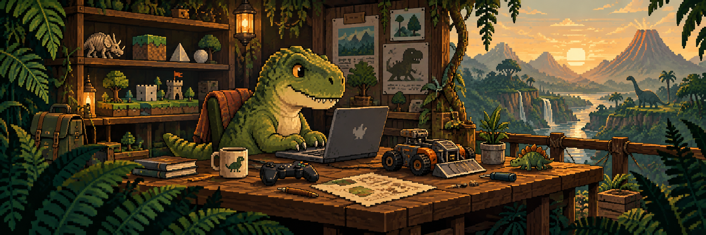

# Hi, I'm Adhir&nbsp;🦖

**Full-stack web developer. Getting started in game development.**

Frontend when the sun's up. Backend when it's not.

I build web interfaces with JavaScript, TypeScript, React, and Next.js, and backends with **PHP and Node.js**. MySQL handles the data. PHP is still my favorite. 🐐

I also work with Go, Python, and Laravel, and I'm expanding my knowledge of AI and cybersecurity.

## My toolkit

### Backend

  &nbsp;&nbsp;
  &nbsp;&nbsp;
  &nbsp;&nbsp;
  &nbsp;&nbsp;
  &nbsp;&nbsp;
  

### Frontend

  &nbsp;&nbsp;
  &nbsp;&nbsp;
  &nbsp;&nbsp;
  &nbsp;&nbsp;
  &nbsp;&nbsp;
  

## Learning to make games

Godot for game development, Blender for creating assets. I'm at the beginning, experimenting and learning as I go.

  &nbsp;&nbsp;
  

## From my web projects

- [Play my 2048](https://adhir2099.github.io/2048/), built with JavaScript, PixiJS, and GSAP. [Source code](https://github.com/adhir2099/2048).
- [Explore PokeApp](https://poke-dex-app-two.vercel.app/), a Pokédex built with Next.js and TypeScript. [Source code](https://github.com/adhir2099/PokeApp).

## Beyond the code

Dinosaurs, battle bots, and games are always good conversation starters.

[Talk tech with me on LinkedIn](https://www.linkedin.com/in/adhir-serrano/) · [Browse my repositories](https://github.com/adhir2099?tab=repositories)
